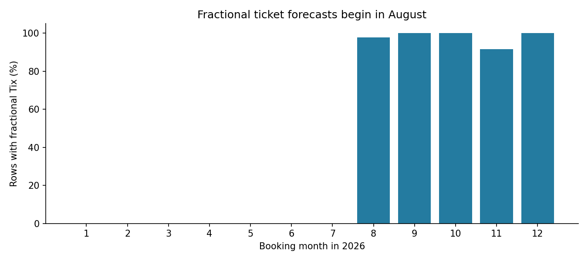
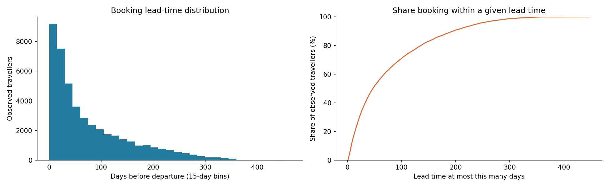
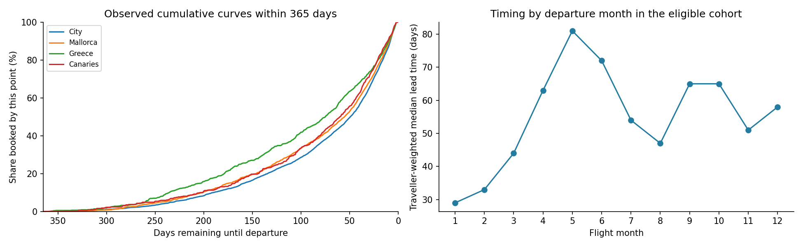
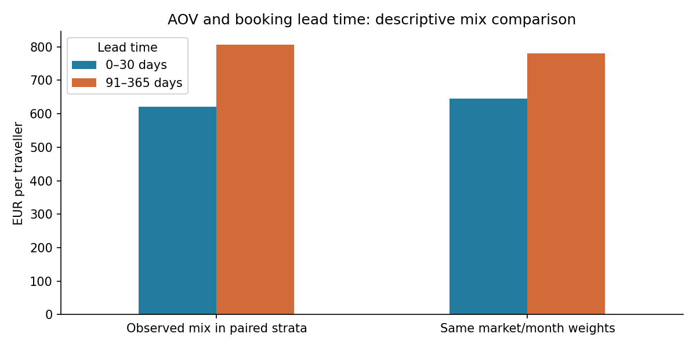

# Initial data analysis

Analysis run on 6 November 2026 using read-only queries of the three raw Delta
tables in `workspace.ewh_dev`. The executed
[notebook](../notebooks/01_data_analysis.ipynb) contains the calculations and
charts. The [research review](../docs/literature_review.md) explains why these
questions were investigated. No forecasting model has been fitted.

The brief explicitly describes a dummy dataset. Research and industry reports
help assess plausible behaviour, but cannot establish the cause of an individual
record without the generator or additional business fields. See the
[anomaly interpretation](../docs/anomaly_interpretation.md) for evidence and limits.

## What the data represents

The actuals contain 20,142 rows representing 45,453 travellers and EUR 33,314,149
of revenue. Booking dates run from 1 January 2024 to 31 December 2025. Flight
dates extend into 2026. A row is a recorded booking-date/flight-date/market
combination, not necessarily one identifiable booking or traveller.

The booking forecast contains 2,452 date/market rows for 2026; the flight
forecast contains 2,083. Both contain 14 markets. Actuals contain 15, including
Nordics, which is absent from both forecasts.

## Main findings and their implications

| Observation | Evidence | Implication |
| --- | --- | --- |
| Most historical volume is concentrated in two markets | City accounts for 51.40% of travellers, Mallorca 22.06% | An overall score could hide poor performance in small markets |
| Booking timing has a long tail | Traveller-weighted median 47 days, mean 76.80 days and 90th percentile 195 days, excluding one negative-lead row | A single average lead time would lose important information |
| The observation window affects timing summaries | The last-365-day window for 2025 departures has a weighted median of 55 days and 90th percentile of 200 days | Examine cohort coverage before estimating booking curves |
| Sparse markets contain little evidence | Nordics has 11 rows/23 travellers; Cyprus 82 rows/197 travellers; Malta 92 rows/202 travellers | Fine market-by-season distributions may need pooling or smoothing later |
| Source anomalies need interpretation | One negative-lead row; 16 zero-revenue actual rows; 3 and 2 zero-revenue rows in the booking and flight forecasts | Preserve raw values and document any analysis-only exclusions |
| Forecast ticket values are not all whole people | 1,023 booking forecast rows have fractional Tix | Preserve expected volumes; do not round before reconciliation |
| Forecast support is incomplete | Booking forecast has no 31 December rows; many date/market combinations are absent | Clarify whether absent keys mean zero or are outside the required scope |
| Fixing observed prior-year bookings creates local conflicts under a final-total interpretation | Two shared date/market keys exceed forecast tickets; one exceeds forecast revenue | Cannot add only nonnegative future sales at those keys and still match both amounts |

No null fields, blank markets, duplicate observed keys, nonpositive ticket
counts or negative revenues were found in any of the three analysis inputs.
These checks do not establish completeness of the company's underlying business.

### Fractional tickets have a monthly structure

All Revenue values in the supplied inputs are whole euros. Fractional values
occur only in booking-forecast Tix: 1,023 of 2,452 rows. January–July contains
no fractional tickets. The monthly counts from August onwards are:

| Month | Supplied rows | Fractional Tix rows | One compatible factor, approximately |
| --- | ---: | ---: | ---: |
| August | 299 | 292 | 0.899877 |
| September | 192 | 192 | 1.034071 |
| October | 189 | 189 | 1.012090 |
| November | 179 | 164 | 1.002038 |
| December | 186 | 186 | 1.015662 |

Starting from the supplementary review's near-one factors, the notebook infers
nearby positive integer counts and intersects each row's factor interval under
two-decimal half-up rounding. For each month, one factor inside the common
interval reconstructs every supplied value exactly: 1,045 August–December rows.
Some scaled values round to integers, explaining why this exceeds 1,023.

This is evidence compatible with systematic monthly construction or adjustment,
not proof of the original algorithm, rounding convention or author's intention.
The factor intervals and inferred integer counts are not unique recovered source
parameters. No forecast value is reversed or replaced. The monthly AOV diagnostic
holds supplied revenue fixed; it does not establish whether revenue was also
adjusted. In the North Africa example, substituting two inferred tickets for
2.07 increases AOV from EUR 9,513.04 to EUR 9,846, so it does not explain away
the unusually high price. See notebook section 3b for calculations and limits.

### Supplementary anomaly review

The notebook also screens for AOV above EUR 5,000 across all inputs, positive
AOV below EUR 100 in actuals, more than 20 travellers per historical row, and
historical lead times of at least 365 days. These are exploratory thresholds,
not company-approved validity limits or evidence of incorrect records.

| Review rule | Actuals | Booking forecast | Flight forecast |
| --- | ---: | ---: | ---: |
| AOV above EUR 5,000 | 5 | 1 | 1 |
| Positive AOV below EUR 100 | 3 | Not screened | Not screened |
| More than 20 travellers in a historical row | 5 | Not applicable | Not applicable |
| Historical lead time at least 365 days | 10 | Not applicable | Not applicable |

Together with zero-revenue and negative-lead flags, these rules identify 47
distinct rows: 40 actuals, four booking forecasts and three flight forecasts.
The largest historical row represents 36 travellers; it is not necessarily one
group booking. The longest observed lead time is 448 days. A 365-day lead is
flagged by this exploratory screen but is still inside the last-365-day cohort.

All candidates remain in the main summaries, except the existing negative-lead
timing exclusion. The notebook reports affected ticket/revenue shares and a
separate sensitivity table of hypothetical historical omissions. These are
diagnostics, not corrected data or a recommended training population. Small
overall changes would not rule out larger effects within a small market.
Holiday duration and other product details would be needed to interpret price
extremes more confidently; no per-night validity limits can be inferred here.

The follow-up compares candidate AOVs with other records in the same dataset,
market and calendar year/quarter, leaving the candidate out. Historical rows
use flight quarter; forecasts use their own date dimension. All ten price
candidates have at least 20 quarter peers. The EUR 8,394 North Africa historical
AOV is 8.39 times its peer weighted median; the EUR 50 Mallorca AOV is 0.08 times
its peer median. Their extremes remain after this limited market/season comparison,
but that still does not establish an error or its cause.

The forty historical flags represent 0.52% of travellers and 0.48% of revenue.
Hypothetically omitting them changes overall AOV from EUR 732.94 to EUR 733.23.
Within North Africa the corresponding AOV change is -1.59%, and within Canaries
-0.75%. These all-history AOVs include the negative-lead row before omission;
the separate timing sensitivity starts from the nonnegative-lead population.
Zero-revenue actuals represent 41 travellers across four markets and both booking
years; this spread cannot identify whether the values are valid or generated.

The cross-file zero-revenue market counts are:

| Market | Actuals | Booking forecast | Flight forecast |
| --- | ---: | ---: | ---: |
| Mallorca | 8 | 1 | 0 |
| City | 6 | 0 | 0 |
| Greece | 1 | 1 | 0 |
| Iberian Peninsula | 1 | 1 | 0 |
| Canaries | 0 | 0 | 1 |
| Balkans | 0 | 0 | 1 |

All three booking-forecast zero markets occur among historical zero revenues;
the two flight-forecast zero markets do not. Twelve historical zeros and all
three booking-forecast zeros have Tix equal to two; one flight-forecast zero
has two tickets and the other has one. Shared market labels or counts alone
do not identify the same booking.

For each forecast zero, the notebook tests historical zeros in the same market
and corresponding date dimension, using calendar dates one/two years earlier
and shifts of 52/104 weeks. All eight rule/year/dataset combinations have zero
matched targets. This limited search does not prove independence or identify
generation lineage. A zero-revenue booking allocation could contribute to a
positive-revenue flight margin alongside other paying allocations; it does not
need to connect to a zero-revenue flight margin.

Historical 31 December bookings represent 57 travellers in 2024 and 18 in 2025.
That makes blanket assumptions about an inactive year-end date inappropriate;
it does not establish the missing 2026 booking forecast's intended value.

Long positive lead times remain valid review candidates. In particular, a
365-day maximum must not be inferred from the lookback sensitivity window.
External evidence supporting longer possible flight-booking horizons is linked
in the [interpretation note](../docs/anomaly_interpretation.md#industry-evidence-and-its-limits).

## Timing and seasonality

Of 45,451 travellers with nonnegative recorded lead times, 37.72% booked within
30 days of departure and 12.12% booked more than 180 days ahead. The corresponding
unweighted row median is 44 days, compared with the traveller-weighted 47 days.
Weighting matters because records carry different numbers of travellers.

The eligible last-365-day cohort contains 9,833 rows and 21,994 travellers with
flight dates throughout 2025. Every selected departure has its preceding
365-day window inside the observed booking-date bounds. This is not proof that
all lifetime bookings are observed: bookings made more than 365 days earlier
are deliberately outside the comparison.

The cumulative market curves and departure-month medians show different timing
patterns in the eligible cohort. Greece's curve tends to accumulate earlier
than City's. This is descriptive evidence for considering market and season;
it is not a significance test or proof that the differences will persist.

Monthly booking activity and monthly flight activity have different shapes.
The 2026 historical flight series includes only bookings made before the end
of 2025, so its low volume is not evidence of a fall in final 2026 demand.
Early 2024 flight cohorts may lack earlier bookings too. Only two booking years
are available; holiday effects and stable annual trends cannot be established
with confidence from this alone.

## Forecast totals require cross-year flows

| Forecast view | Travellers | Revenue (EUR) |
| --- | ---: | ---: |
| Bookings made in 2026 | 23,012.74 | 18,988,449.00 |
| Flights departing in 2026 | 22,413.00 | 18,330,715.00 |
| Booking minus flight | 599.74 | 657,734.00 |

A table restricted to booking dates in 2026 **and** flight dates in 2026 cannot
have these unequal totals as both sets of enclosed margins. Cross-year bookings
and flights must be represented or scoped explicitly. The brief acknowledges
cross-year activity; the gap is not automatically a data error.

There are 5,110 potential calendar-date/market cells per forecast if all 365
dates are crossed with its 14 markets. Of these, 2,658 cells are absent from the
booking forecast and 3,027 from the flight forecast. Absence is recorded as
unspecified in this analysis, rather than automatically filled with zero.

## Prior-year bookings are not automatically compatible with the forecast

Actuals contain 1,327 rows, 3,111 travellers and EUR 2,635,901 for flights in 2026,
booked in earlier years. Two shared date/market keys show the following:

| Flight date | Market | Forecast Tix | Observed Tix | Forecast revenue (EUR) | Observed revenue (EUR) |
| --- | --- | ---: | ---: | ---: | ---: |
| 2026-09-02 | Mallorca | 12 | 13 | 14,494 | 12,502 |
| 2026-10-10 | Iberian Peninsula | 3 | 9 | 5,576 | 7,355 |

If these observations must remain fixed and the forecast gives final totals,
the first key would require minus one additional traveller and the second
minus six travellers and minus EUR 1,779. Nonnegative additional sales cannot
meet those requirements. Separately, 12 observed date/market keys have no
corresponding flight forecast row. Their target amounts are unspecified.

This is a **conditional incompatibility**, not a declaration that the entire
assignment is impossible. Clarify forecast meaning, scope and whether historical
amounts must be fixed before deciding how to handle these keys. No values were
clipped, redistributed or replaced in this analysis.

The notebook's illustrative annual balance uses only the 14 shared forecast
markets: their observed incoming amounts are 3,098 travellers and EUR 2,620,590.
The remaining 13 travellers/EUR 15,311 belong to Nordics and stay in historical
context, outside that illustration. If incoming amounts were complete and the
forecast totals represented a complete annual scope, implied outgoing amounts
would be 3,697.74 travellers/EUR 3,278,324. Absent daily targets remain
unspecified; these conditional annual amounts do not resolve local conflicts
or prove feasibility.

## Revenue and evaluation

The two marginal forecasts do not identify a unique joint booking-to-flight
table. Many different allocations can have the same totals. Historical patterns
can help choose plausible allocations; the supplied margins alone cannot prove
that any one set of 2026 date connections is the true future relationship.

AOV is calculated as summed revenue divided by summed travellers. It varies
across markets and lead-time bands. This does not establish that changing
booking timing would cause revenue to change. Independently fitting ticket
and revenue matrices could produce unreasonable cell AOVs, so the eventual
solution must check both measures together.

The supplied forecasts have five zero-revenue targets with positive Tix and
two targets with AOV above EUR 5,000. If all positive-ticket joint cells had
AOV between EUR 100 and EUR 5,000 and zero-ticket cells carried zero revenue,
every marginal AOV would be inside that interval too. Therefore our exploratory
price cutoffs cannot become universal cell constraints while preserving all
supplied targets. This is a necessary-condition check, not a complete feasibility
assessment or justification for changing target amounts.

To investigate the AOV/lead association, the notebook pairs short (0–30 day) and
long (91–365 day) lead groups within the same market/flight-month strata of the
2025 departure cohort. Each group must have five rows and ten travellers per
stratum. The 61 eligible strata retain 13,530 of 14,886 selected travellers.
Their ordinary group AOVs are EUR 620.04 and EUR 805.59. Giving both groups the
same combined-ticket market/month weights yields EUR 644.37 and EUR 779.71:
the gap decreases from EUR 185.55 to EUR 135.33. Product mix accounts for part
of this descriptive difference; remaining differences cannot be interpreted as
a causal price effect of booking earlier.

A later evaluation should report two distinct things: violations of supplied
marginal constraints, and error/plausibility of the joint allocations. Zero
marginal error alone says nothing about whether the allocation is realistic.
Temporal validation must respect the observation window and avoid using future
bookings to estimate historical forecast-origin features. Supplying true held-out
margins tests conditional allocation, not end-to-end demand forecasting.

This notebook explores both historical years. Neither should subsequently be
described as a completely untouched blind test set. There are no held-out
predictions or forecast accuracy claims at this stage.

## Decisions needed before modelling

1. Does the flight forecast mean final departure totals or additional future sales?
2. Must prior-year observed bookings be preserved as fixed amounts?
3. Are absent forecast date/market keys zero, unconstrained, or outside scope?
4. Which cross-year dates and maximum lead-time support should the output cover?
5. What constitutes acceptable cell-level AOV and booking-pattern distortion?

The next modelling step should start with an explicit feasibility specification
and a simple baseline. More flexible ML methods should be considered only if
their benefit can be demonstrated with an appropriate validation experiment.
